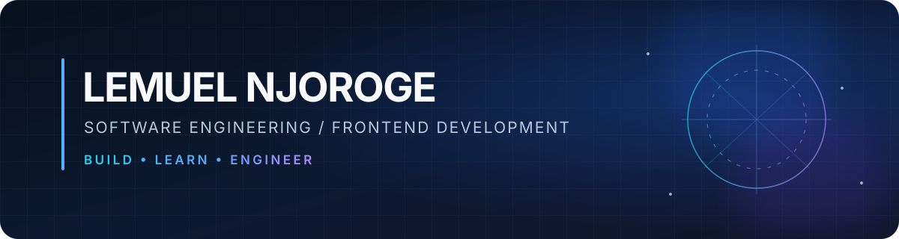

  

  

  
  
  

---

## About

I'm **Lemuel Njoroge**, a Software Engineering student at **Kirinyaga University, Kenya**, interested in building practical software and thoughtful digital experiences.

My current focus is frontend development with React and TypeScript, responsive interface design, and exploring how AI can make applications more useful. I enjoy taking an idea from an early concept to a working product while strengthening the engineering fundamentals behind it.

## Technology

**Languages**

  

**Frameworks and UI**

  

**Tools**

  

**Working knowledge:** responsive web design, interactive interfaces, UI/UX fundamentals and database management fundamentals.

**Exploring:** AI API integration, backend development, database architecture and software design.

## Selected Work

### [LostLink AI](https://github.com/LostLinkAi/lostlinkai_frontend)
A collaborative frontend project exploring a smarter lost-property experience. It brings together lost and found reports and presents potential matches to help people reconnect with misplaced belongings.

**React 19** · **TypeScript** · **Vite** · **React Router** · **Framer Motion**

The current repository describes a frontend prototype: demo data is stored locally and match scores are illustrative, not proof of ownership.

[View repository →](https://github.com/LostLinkAi/lostlinkai_frontend)

### [Personal Portfolio](https://portfolio-lemuel.vercel.app/)
My personal portfolio: a place to explore my development work, technical interests and ongoing journey in software engineering.

**React** · **TypeScript** · **Vite**

[Live portfolio →](https://portfolio-lemuel.vercel.app/) · [Source code →](https://github.com/LemuelXd/actual-portfoliuo)

## Current Interests

- Building responsive, accessible and maintainable web interfaces.
- Deepening my understanding of React and TypeScript.
- Exploring practical AI integrations.
- Strengthening backend, database and software architecture fundamentals.

## Connect

  
  
  

  Curious by nature. Building with purpose.

